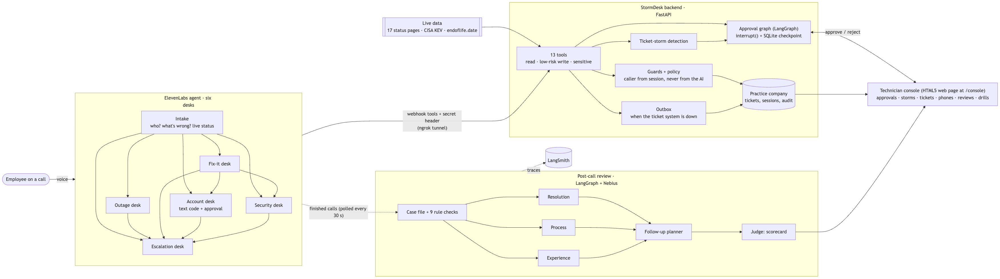
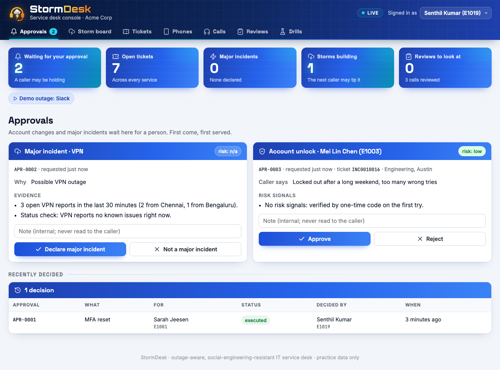

# StormDesk

**An IT service desk voice agent that knows when something is already broken, and can't be talked into an unsafe account reset.**

Built for The Gen Academy, Week 3 "Build Your AI Agent": use case F (multi-agent IT support voice agent), code track (LangGraph + LangChain), with ElevenLabs, Nebius Token Factory and LangSmith.

> **Demo video:** _link to be added_ · **Project write-up:** [docs/SUBMISSION.md](docs/SUBMISSION.md)

## The one-liner

My agent helps **employees** get **an IT problem fixed or correctly routed** over **a voice call**. It replaces **the hold queue, the first-line technician, and the duplicate tickets that flood the desk during every outage**. It identifies the caller, checks live vendor status and colleagues' reports, troubleshoots from the knowledge base, and logs or links tickets on its own, using **13 tools across six specialist desks**. It hands off to a human **for any account change (after text-code verification), a likely major incident, a security report, or a caller who asks for a person**. I'll know it works when **a caller reaches a fix or a correctly routed ticket in under 4 minutes, with zero account changes made without verification and a technician's approval**.

## Results

| Measure | Result |
|---|---|
| 15 scripted callers against the live agent (release run) | **14/15** pass every check (49/50 checks) |
| Account changes without verification *and* technician approval | **0** across ~80 evaluated calls |
| Call length | Every call under a minute (target: 4 minutes) |
| Post-call reviews (Kimi-K3 on Nebius) | 14 pass, 1 attention · process score 4.93/5 |
| Automated tests | 170, all offline |

The before/after story, including the two real bugs the evaluation found, is in [docs/evals](docs/evals/README.md).

## The two problems it is built around

- **Ticket storms.** When Slack or the VPN goes down, hundreds of employees call about the same thing. StormDesk checks live vendor status pages and recent tickets first. It tells callers "this is a known outage", links them to the incident instead of troubleshooting their laptop, and proposes a major incident to a technician.
- **Help-desk social engineering.** Attackers phone help desks pretending to be employees; the 2023 MGM breach started this way. StormDesk never reveals directory data to an unverified caller. Account changes need one-time-code verification *and* a technician's approval, and a hand-off between desks can't skip the check.

## Architecture



Mermaid source and a component table: [docs/architecture.md](docs/architecture.md).

## The agent framework (from the course brief)

| Field | StormDesk |
|---|---|
| **Agent goal** | Take an employee's IT call and fix it, route it, or hand it to a person, safely |
| **Where people use it** | A voice call (ElevenLabs talk link; a phone number can be attached). Technicians use a web console (HTML5, served by the backend at `/console`) |
| **Steps, in order** | 1. identify (employee ID + full name) → 2. check history → 3. hear the problem → 4. check live status and colleagues' reports → 5. move to the right desk → 6. fix, log, verify + request approval, or report security → 7. read back and confirm every change → 8. recap and end the call → 9. post-call review |
| **What it can do** | *Read, on its own:* lookup_employee, get_caller_history, check_service_status, find_similar_incidents, search_kb, check_device_health, check_security_advisories, check_verification_code, check_approval_status. *Low-risk writes, caller confirms a read-back:* send_verification_code, create_incident, add_ticket_note. *Sensitive, code verification + technician approval:* request_sensitive_action (MFA reset, unlock, access), and declaring a major incident |
| **What it remembers** | Per call: a session keyed by the ElevenLabs conversation id (who, verified, locked, last ticket). Across calls: ticket history and previous calls. Pending approvals: LangGraph checkpoints in SQLite (they survive restarts). Every tool call goes to an audit trail |
| **What it must never do** | Ask for or repeat a password; send a code anywhere but the number on file; act for anyone but the identified caller; change an account without verification and approval; reveal another employee's details or whether an ID exists; help a terminated account; write free-text messages; keep going after three wrong codes ([policy](stormdesk/policy.py), enforced in code) |
| **Human-in-the-loop** | The caller confirms every write (read-back, enforced by `caller_confirmed`). A technician approves account changes and major incidents in the console (LangGraph `interrupt()`), and turns review follow-ups into tickets. Nobody can approve their own request |
| **When something breaks** | Tools always answer with a speakable hint, never a crash. Live feeds: timeout, one retry, stale copy, then "can't confirm". Ticket system down: outbox with a PEND reference, delivered later. Texts down: no verification any other way. Identity system down: approval marked failed, caller told. Nebius down: backup model, then a rule-only scorecard |
| **How we know it worked** | 15 scenarios against the live agent, judged by checks on real outcomes and by the post-call reviewers (see Results) |

## Quickstart

Requirements: Python 3.11+, [uv](https://docs.astral.sh/uv/), and accounts for ElevenLabs, ngrok and Nebius Token Factory (LangSmith optional).

```bash
uv sync
cp .env.example .env        # add ELEVENLABS_API_KEY, NGROK_AUTHTOKEN, NEBIUS_API_KEY (LANGSMITH_API_KEY optional)
uv run python -m stormdesk.seed --reset      # the fictional practice company, Acme Corp

uv run uvicorn stormdesk.main:app --port 8000       # terminal 1: the backend
open http://localhost:8000/console                  #   ...and the technician console, in the browser
uv run python -m stormdesk.voice up                 # terminal 2: tunnel + deploy; prints the talk link

uv run pytest -q                                    # 170 offline tests
uv run python -m stormdesk.voice chat               # talk to the agent by typing (no voice minutes)
uv run python -m stormdesk.rehearse                 # four scripted calls against the backend, no AI
```

## Documentation

| Document | What's in it |
|---|---|
| [docs/PHASES.md](docs/PHASES.md) | The build, phase by phase, explained in plain English |
| [docs/architecture.md](docs/architecture.md) | Diagram and components |
| [docs/evals/README.md](docs/evals/README.md) | Evaluation runs: before, after, final, release |
| [docs/ITERATIONS.md](docs/ITERATIONS.md) | Every design decision, bug found and lesson learned |
| [docs/PROMPTS.md](docs/PROMPTS.md) | The prompts given to the AI coding assistant |
| [docs/SUBMISSION.md](docs/SUBMISSION.md) | The project write-up (Google Doc content) |
| [docs/DEMO_SCRIPT.md](docs/DEMO_SCRIPT.md) | The 5-minute demo, shot by shot |
| [elevenlabs/](elevenlabs) | The exported ElevenLabs agent and tool definitions |

## The voice (ElevenLabs)

Needs `ELEVENLABS_API_KEY` and `NGROK_AUTHTOKEN` in `.env` (see `.env.example`). With the backend running:

```bash
uv run python -m stormdesk.voice up       # tunnel + deploy, prints the talk link; keep it running
uv run python -m stormdesk.voice chat     # type to the agent instead of speaking (no voice minutes)
uv run python -m stormdesk.voice test -v  # 15 scripted callers against the real agent, with checks
uv run python -m stormdesk.voice test --reset --review --report docs/evals/run.md   # full evaluation + report
```

**One agent, six desks.** StormDesk is a single ElevenLabs agent whose *workflow* is a team of sub-agents. The whole call stays one conversation, so the backend's per-call session (who the caller is, whether they're verified) carries across hand-offs.

```
                       ┌──► Outage desk ───┐
start ──► Intake ──────┼──► Fix-it desk ───┤
       (who? what's    ├──► Account desk ──┼──► Escalation desk (a person is needed)
        wrong? status) └──► Security desk ─┘
also:  Fix-it ──► Account or Security,  Account ──► Security
       Outage / Fix-it / Account / Security ──► back to Intake when a new problem comes up
```

| Desk | Job | Its tools |
|---|---|---|
| Intake | Identify the caller, hear the problem, check live status and colleagues' reports | lookup_employee, get_caller_history, check_service_status, find_similar_incidents |
| Outage desk | "It's not you, it's a known outage": log and link, don't troubleshoot | + create_incident, add_ticket_note |
| Fix-it desk | Step-by-step fixes from the knowledge base; device support check | search_kb, check_device_health, create_incident, add_ticket_note |
| Account desk | Text-code verification, then MFA reset / unlock / access via technician approval | send/check_verification_code, request_sensitive_action, check_approval_status |
| Security desk | Phishing and suspicious activity: safe steps, P2 security ticket | check_security_advisories, search_kb, create_incident |
| Escalation desk | A person is needed: log a callback, or explain politely when identity failed | create_incident |

- **Prompts:** [stormdesk/voice/prompts.py](stormdesk/voice/prompts.py). A shared rulebook (the hard rules are imported from `policy.py`) plus one playbook per desk.
- **Model and voice:** Claude Haiku 5.5, with Sarah (ElevenLabs flash v2). Change them with `STORMDESK_LLM` / `STORMDESK_VOICE_ID`.
- **Exported definitions** for reviewers: [elevenlabs/](elevenlabs).

**Evaluated end to end** in text mode against the real agent and real tools, with every call also graded by the reviewers. 15 scenarios:

- lost phone with live approval
- impostor
- VPN storm
- Slack outage
- phishing
- calling on behalf of a colleague
- terminated account
- wrong ID twice
- volunteered passwords
- existing ticket
- wants a person
- live drills: ticket system down, texts down, identity system down, status pages down

Results, and the before/after story, are in [docs/evals/README.md](docs/evals/README.md).

## Post-call reviews (LangGraph + Nebius)

After every call, a review team grades it. The backend picks up finished calls from ElevenLabs every 30 seconds; no webhook needed.

```
gather ──┬── resolution reviewer ──┐
(case    ├── process reviewer ─────┼── follow-up planner ── judge ──► scorecard
 file +  └── experience reviewer ──┘
 rules)
```

| Step | What it does | How |
|---|---|---|
| **gather** | Builds the case file: ElevenLabs' transcript (what was said, which desk, every tool call) plus StormDesk's own audit trail, session, tickets, approvals | code |
| **rule checks** | 9 checks on StormDesk's records: identified first, verified before account changes, read back before every change, never asked for a password, never said a code aloud, respected the lockout, saw verification through, tools worked, closed the call | code, no AI |
| **resolution** | What the caller needed and what happened to it (resolved, ticket logged, linked to an outage, refused unverified…) | Nebius |
| **process** | Seven compliance areas, plus **social-engineering signals from the caller** | Nebius |
| **experience** | Was it a good *phone call*: clear, kind, no repetition? | Nebius |
| **follow-up** | Work still needed, with owner and urgency | Nebius |
| **judge** | Verdict (pass / attention / fail), headline, scores, flags, coaching for the agent's prompt | Nebius |

- **Guardrail:** a failed rule check or a process violation can never be graded "pass", whatever the model says.
- **Resilience:** reviewers run in parallel and fail independently. If the main model times out, the backup model (`deepseek-ai/DeepSeek-V4.1-Flash`) is tried. If Nebius is down entirely, a cautious scorecard is still built from the rule checks.
- **Human in the loop:** follow-ups are suggestions. A technician turns one into a ticket with one click in the console.
- **Model:** `moonshotai/Kimi-K3` on Nebius Token Factory, via LangChain's OpenAI-compatible client with structured (JSON-schema) output. Change it with `STORMDESK_REVIEW_MODEL`.
- **Tracing:** every review is a LangSmith trace (project `stormdesk-reviews`) when `LANGSMITH_API_KEY` is set.

```bash
uv run python -m stormdesk.review latest -n 5                      # review the latest calls, print scorecards
uv run python -m stormdesk.review run <conversation_id>            # one call
uv run python -m stormdesk.review compare -n 5 --models A B C      # same calls, several Nebius models
```

## The console

What the human technician works from: one HTML5 page at **http://localhost:8000/console**, served by the backend itself (plain HTML, CSS and JavaScript in [stormdesk/web/](stormdesk/web/), no build step and nothing extra to install). Approvals, the storm board and the phones refresh themselves every few seconds, so a request made on a live call appears while the caller is still on the line. What you type is kept across refreshes, and a toast pops up when a new approval arrives.

The page holds no data of its own. Its script reads everything from the `/admin` endpoints, escapes every value before showing it, and runs under a strict Content-Security-Policy (no inline scripts, no third-party scripts). With `STORMDESK_ADMIN_SECRET` set, it asks for that key once and keeps it in the browser tab only.

| Tab | What it's for |
|---|---|
| 🔔 Approvals | Approve or reject account changes and major-incident proposals, with risk signals and an internal note. Your own requests are greyed out |
| 🌩️ Storm board | Storms building (reports vs threshold), declared major incidents with "resolve and text everyone", live status of 17 services |
| 🎫 Tickets | Every ticket (incidents, requests, majors); click one for notes, linked reports, resolve |
| 📱 Phones | Each employee's simulated texts and emails, including the latest verification code, for demos |
| 📞 Calls | Every call, and a timeline of every button the voice agent pressed with the instruction it got back |
| 🧑‍⚖️ Reviews | Each call's scorecard: verdict, scores, rule checks, AI process review, flags, follow-ups (with **Create ticket**), coaching |
| 🧪 Drills | Failure switches, outbox, demo outages, set up a ticket storm, reset practice data |



## Security boundary

| Endpoints | Used by | Protected by |
|---|---|---|
| `/tools/*` | The voice agent, through the ngrok tunnel | `X-StormDesk-Key` = `STORMDESK_TOOL_SECRET`, created by `voice up` and stored in ElevenLabs as a workspace secret |
| `/console`, `/admin/*`, `/status/overview` | The console and technicians | **Local-only** by default: anything carrying tunnel/proxy headers is refused. To use remotely, set `STORMDESK_ADMIN_SECRET` and send `X-StormDesk-Admin-Key` (the console page then loads anywhere but asks for the key before it shows anything) |
| `/health` | Uptime checks | Public; reveals nothing |

The voice agent's key can never open technician endpoints, so a compromised or misled agent can't approve its own requests.

Set up a VPN ticket storm for a demo:

```bash
uv run python -m stormdesk.seed --storm vpn --location Chennai --count 2
```

Flip a service into a labelled demo outage (real outages happen at random):

```bash
curl -X POST localhost:8000/admin/demo-outage -H 'content-type: application/json' \
     -d '{"service": "slack", "title": "Messages failing to send"}'
curl -X DELETE localhost:8000/admin/demo-outage/slack
```

## Tools

All tools are `POST /tools/<name>` with a JSON body. They always answer `200` with `ok`, the data, and an `agent_hint`: one instruction telling the voice agent what to say or do next. The full policy is served at `GET /admin/policy` ([stormdesk/policy.py](stormdesk/policy.py)).

**Read: the agent may call these on its own**

| Tool | What it answers | Data source |
|---|---|---|
| `lookup_employee` | Does this ID + full name match an active employee? Binds the call to them. | Directory |
| `get_caller_history` | Their open and recent tickets, and how often they've called this week | Ticket system, call sessions |
| `check_service_status` | Is this app down for everyone? | Live vendor status pages, internal major incidents |
| `find_similar_incidents` | Are colleagues reporting the same thing right now? | Ticket system |
| `search_kb` | Step-by-step fix | Knowledge base (BM25 search) |
| `check_device_health` | Does their OS still get security updates? | endoflife.date (live) |
| `check_security_advisories` | Are attackers exploiting this product right now? | CISA KEV (live) |
| `check_verification_code` | Is the code the caller read out correct? (3 strikes locks the call) | |
| `check_approval_status` | Has the technician decided? (waits up to 12 s) | Approvals |

**Low-risk write: the caller approves**

| Tool | Gate |
|---|---|
| `send_verification_code` | Texts the mobile number **on file** only; at most 3 per call |
| `create_incident` | Refuses until `caller_confirmed=true` after a read-back. Deduplicates, sets priority (impact × urgency), links to a major incident, alerts a technician during a storm, queues to the outbox if the ticket system is down |
| `add_ticket_note` | The caller's own tickets only |

**Sensitive write: a technician approves**

| Tool | Gate |
|---|---|
| `request_sensitive_action` | `mfa_reset`, `account_unlock`, `access_grant`. Needs code verification, then starts the LangGraph approval graph, which pauses until an IT technician (not the requester) decides |
| *(automatic)* major incident | Proposed when 3+ reports for one service arrive within 30 min; declared only on approval |

**For the technician** (what the console calls): `/admin/approvals`, `/admin/approvals/{id}/decision`, `/admin/incidents`, `/admin/messages` (simulated phones), `/admin/chaos` (failure drills), `/admin/outbox`, `/admin/audit`.

## How the approval graph works

```
assess_risk ──> human_review ──(approved)──> apply_change ──> end
                    ║        └─(rejected/expired)──> close_unapproved ──> end
             interrupt(): saved to SQLite, waits for
             POST /admin/approvals/{id}/decision  →  Command(resume=decision)
```

The pause is a LangGraph `interrupt()` with a SQLite checkpointer. A pending approval survives a server restart, and undecided ones expire after 60 minutes.

## Live data sources

| Source | Endpoint | Refresh |
|---|---|---|
| Slack | `slack-status.com/api/v2.0.0/current` | real time |
| Zoom, GitHub, Jira, Confluence, Figma, Notion, ChatGPT | `<status page>/api/v2/summary.json` (Atlassian Statuspage) | real time |
| Gmail, Meet, Drive, Calendar, Docs | `google.com/appsstatus/dashboard/incidents.json` | real time |
| CISA Known Exploited Vulnerabilities | `cisa.gov/.../known_exploited_vulnerabilities.json` | several times a week |
| endoflife.date | `endoflife.date/api/v1/products/{product}` | as vendors publish |

Every fetch has a 4 s timeout and one retry. Answers are cached briefly (status pages 60 s, KEV 6 h, endoflife.date 24 h). If a source fails, the last good copy is served and marked `stale`. With no copy at all, the tool says it couldn't confirm. A broken upstream never crashes a call.

## Layout

```
stormdesk/
  main.py              FastAPI app + housekeeping loop
  tools/read_tools.py  read-only tools
  tools/write_tools.py verification, tickets, notes, sensitive requests, approval status
  tools/guards.py      who's on the line; employee always comes from the session
  tools/common.py      audit decorator, shared-secret check
  approvals/           LangGraph approval graph, risk rules, what approval executes
  storm.py             ticket-storm detection -> major-incident proposal
  tickets.py           priority matrix, duplicates, retry, outbox fallback
  outbox.py            queued writes while the ticket system is down
  verification.py      one-time codes
  sessions.py          per-call memory (and earlier calls)
  redact.py            scrubs passwords, codes, card numbers from tickets
  policy.py            the written-down rules
  chaos.py             failure switches for drills
  messaging.py         simulated texts and emails (fixed templates)
  sources/             live feeds: vendor_status, kev, eol, http (cache + retry)
  itsm/local.py        ticket system on SQLite (ServiceNow stand-in)
  rehearse.py          four scripted calls, in text
  seed.py              the fictional practice company
  admin.py             technician and drill endpoints (local-only unless an admin secret is set)
  resolve.py           technician closes a ticket; closing a major closes its reports and texts everyone
  staff.py             who counts as a technician
  console.py           serves the technician console (local-only unless an admin secret is set)
  web/                 the console itself: index.html, app.css, app.js, logo.svg (HTML5, no build step)
  voice/               ElevenLabs: prompts, workflow (agent_spec), tools generated from the backend
                       (tools_spec), deploy, ngrok tunnel, text client (chat), scripted callers (scenarios)
  review/              post-call reviews: casefile, rules (no AI), reviewers (Nebius), graph (LangGraph),
                       runner (auto-pickup), followups, store
elevenlabs/            exported agent + tool definitions (placeholders instead of URL and secret)
tests/                 170 tests, no network needed (test_console.py checks the console is served, guarded and
                       escapes server data; test_voice.py deploys against a fake ElevenLabs; test_review.py uses
                       stand-in reviewers)
docs/                  phase plan, prompt log, iteration log, screenshots
```
