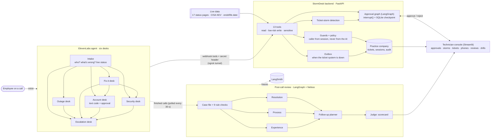

# Architecture

| Part | Technology | Role |
|---|---|---|
| Voice and conversation | ElevenLabs Agents (workflow of six sub-agents), Claude Haiku 5.5, voice "Sarah" | Talks to the caller; each desk has its own playbook and tools; ElevenLabs judges hand-off conditions |
| Tools | FastAPI, generated into ElevenLabs webhook tools from the same Pydantic models | 13 tools in three permission tiers; every answer carries an `agent_hint` |
| Human-in-the-loop | LangGraph `interrupt()` + SQLite checkpointer | Account changes and major incidents pause for a technician; survive restarts |
| Live data | Statuspage / Slack / Google feeds, CISA KEV, endoflife.date | "Is it them or us?", security advisories, out-of-support devices |
| Technician | Streamlit | Approvals, storm board, tickets, simulated phones, call timelines, reviews, failure drills |
| Quality | LangGraph + LangChain on Nebius Token Factory (Kimi-K3, backup DeepSeek-V4.1-Flash), LangSmith | Post-call scorecards; rule checks that the AI can't override |
| Evaluation | 15 scripted callers over ElevenLabs' WebSocket in text mode | Before/after runs with checks and reviews ([evals](evals/README.md)) |
